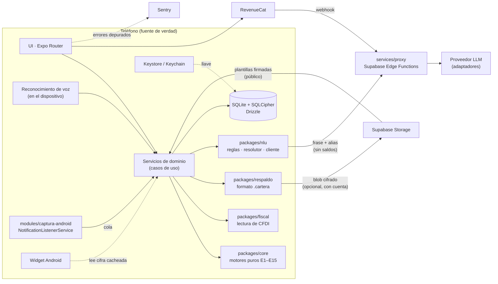

# 03 · Arquitectura

## 1. Vista general



## 2. Principios

1. **Local primero.** El libro vive en el teléfono, cifrado. El servidor no guarda movimientos legibles: solo blobs cifrados que no puede abrir (respaldo, gastos compartidos en v2).
2. **Determinismo.** Todo número sale de `packages/core`. Mismas entradas + misma semilla = misma salida.
3. **Mínima exposición.** Al proxy solo viajan la frase a interpretar y los alias de cuentas, contactos y categorías. Nunca saldos ni historial.
4. **Inmutabilidad.** El libro solo crece; corregir es revertir y reemplazar.
5. **Capas delgadas.** La UI no calcula; los servicios orquestan; los motores calculan; el repositorio persiste.
6. **Ante la duda, contar de más lo que se debe.** Cuando falta información (tránsito, cuentas puente, saldos dudosos), se elige la opción que no infla el dinero libre.

## 3. Stack

| Capa | Elección | Motivo |
|---|---|---|
| Monorepo | pnpm workspaces | Un solo lockfile; Expo soporta monorepos (seguir la guía vigente de Expo al iniciar, incluido el `node-linker` que pida) |
| Lenguaje | TypeScript `strict` + `noUncheckedIndexedAccess` | Errores de índice en motores numéricos son errores de dinero |
| App | Expo (SDK estable vigente al iniciar M2), Nueva Arquitectura, Hermes, Expo Router; builds de desarrollo (no Expo Go) | Velocidad, builds en la nube, un solo código para iOS (M14) |
| Base local | `expo-sqlite` con `useSQLCipher: true` + Drizzle ORM / drizzle-kit | Cifrado en reposo; consultas tipadas; `useLiveQuery` para UI reactiva |
| Validación | Zod | Fronteras: LLM, JSON en base, fixtures, respaldos, plantillas remotas |
| Voz | `expo-speech-recognition` (es-MX, en el dispositivo cuando se soporte) | Sin costo ni audio a nuestros servidores |
| Almacén seguro | `expo-secure-store`; `expo-local-authentication` para bloqueo | Llave de la base y biometría |
| Avisos | `expo-notifications` (solo locales) | Sin servidor de push |
| Tareas en segundo plano | `expo-background-task` | Cortes, ocurrencias, respaldo automático, plantillas remotas |
| Captura Android | Expo Module propio en Kotlin + config plugin | Control total del filtrado nativo (RF-CAP-02) |
| Criptografía (M9, M10) | Primitivas nativas: scrypt, AES-256-GCM, Ed25519 y aleatorios seguros. Elegida en el spike de M9 (`docs/ESTADO.md`): scrypt con `react-native-quick-crypto` (en JS puro `n = 2^17` no cabe en 3 s sin JIT); AES-256-GCM y aleatorios con `expo-crypto`. Ed25519 (M10, solo verificar) con `@noble/curves`: JS puro y auditado, el mismo código en Node y en Hermes; verificar un archivo al día no necesita velocidad nativa | Respaldo cifrado y plantillas firmadas; `packages/respaldo` recibe la criptografía inyectada para probarla en Node |
| Archivos | `expo-sharing`, `expo-document-picker`, `expo-print` (PDF desde HTML), `fflate` (zip/gzip en JS) | Exportar, respaldo, paquete para el contador |
| XML (M12) | Lector XML en JS puro sin evaluación de entidades externas (candidata: `fast-xml-parser`) | CFDI; sin riesgo XXE |
| Widget (M10) | `react-native-android-widget` con config plugin (spike en M10) | "Hoy puedes" en la pantalla de inicio |
| Suscripciones | RevenueCat (`react-native-purchases`) | Tiendas, pruebas gratuitas, webhook de derechos |
| Errores | Sentry con depuración en `beforeSend` | RNF-05 |
| Analítica | PostHog con lista blanca de eventos, solo con opt-in | RNF-05 |
| Backend | Supabase: Auth (anónima; correo con código solo para respaldo en la nube), Edge Functions (Deno), Storage, Postgres para cuotas, derechos y metadatos de respaldo | Mínimo backend; sin datos financieros legibles |
| LLM | Adaptadores por proveedor detrás del proxy; modelo elegido por benchmark en M3 | Sin dependencia de un proveedor |
| Calculadora M0 | Vite + React + TS, sitio estático | Reutiliza `packages/core` |
| Pruebas | Vitest + fast-check (paquetes), jest-expo + Testing Library (app), Maestro (E2E Android) | Ver §10 |
| CI/CD | GitHub Actions; EAS Build y EAS Submit | Ver §11 |

Toda dependencia nueva se justifica en el commit y, si es nativa, se prueba en un build de desarrollo antes de cerrar el hito.

## 4. Estructura del repositorio

```
cartera/
├── CLAUDE.md · README.md
├── docs/                      especificación (este directorio)
├── fixtures/                  vectores, golden set, notificaciones, CFDI y respaldos sintéticos
├── scripts/                   oraculo.mjs (verifica vectores en cualquier SO), firmar-plantillas.mjs
├── config/fiscal/             parámetros fiscales por ejercicio (M11–M12, validados por contador)
├── apps/
│   ├── movil/                 app Expo
│   │   ├── app/               rutas (Expo Router)
│   │   └── src/
│   │       ├── db/            apertura cifrada y migraciones al arrancar
│   │       ├── servicios/     casos de uso: registrar, arqueo, hoy, simular, cortes, respaldo, negocio, fiscal…
│   │       ├── captura/       puente JS del módulo nativo, ingesta, plantillas remotas
│   │       ├── voz/           reconocimiento y estados de grabación
│   │       ├── ui/            componentes y tokens
│   │       └── privacidad/    consentimiento, exportar, borrar
│   └── calculadora/           web pública de M0
├── packages/
│   ├── core/                  motores puros (sin React, sin Expo, sin I/O)
│   ├── datos/                 esquema Drizzle, migraciones SQL, repositorio del libro (agnóstico del driver)
│   ├── nlu/                   esquema Zod, parser de reglas, resolutor, cliente del proxy, eval
│   ├── fiscal/                lectura de CFDI (M12)
│   ├── respaldo/              formato .cartera, cifrado con primitivas inyectadas (M9)
│   └── sincronizacion/        eventos compartidos cifrados (M16, v2)
├── modules/
│   ├── captura-android/       Expo Module (Kotlin) + config plugin
│   └── intents-ios/           App Intent para Atajos (M14, v2)
└── services/
    └── proxy/                 Supabase Edge Functions
```

Reglas de dependencia (las verifica ESLint con `import/no-restricted-paths`):

- `packages/core` no importa nada del repo ni de terceros en tiempo de ejecución.
- `packages/datos` importa `core` y `drizzle-orm`; recibe una instancia de Drizzle ya abierta. En pruebas se usa `better-sqlite3` en Node; en la app, `expo-sqlite` con SQLCipher (abierto en `apps/movil/src/db`).
- `packages/nlu` importa `core` y `zod`.
- `packages/fiscal` importa `core` y el lector XML. `packages/respaldo` y `packages/sincronizacion` importan `core` y `zod`, y reciben la criptografía como interfaz (`{scrypt, aesGcmCifrar, aesGcmDescifrar, xchacha20poly1305Cifrar, xchacha20poly1305Descifrar, aleatorio}`), así se prueban en Node (`node:crypto` para scrypt y AES-GCM; `@noble/ciphers` para XChaCha20-Poly1305, que `node:crypto` no trae) y corren en la app con la biblioteca elegida.
- `apps/*` importan los paquetes. La UI no importa `db/` ni `datos` directamente: pasa por `servicios/`.
- `services/proxy` no importa código de la app; recibe en el build el esquema de proveedor generado desde `nlu` (`services/proxy/_shared/esquema-proveedor.json`, `06 §10.1`).

## 5. Flujos

### 5.1 Registro por voz

1. `voz/` entrega la transcripción final.
2. `nlu.interpretar(texto, contexto)`: nivel de reglas; si no cubre y hay red, proxy; si no hay red, guarda "por interpretar".
3. Validación Zod de la `Interpretacion`; si falla, un reintento con el error; si vuelve a fallar, `aclarar/no_entendi`.
4. `resolutor` convierte alias en cuentas (`06 §5`: con alias en todos los espacios, sin alias solo en el del movimiento); `por_asignar` se traduce a la cuenta puente del sentido. Si el espacio de la cuenta no es el del movimiento, la confirmación lo pregunta y servicios descompone el movimiento (`04 §2.4`).
5. Política de confirmación (`06 §7`) → registro optimista o tarjeta de confirmación.
6. `servicios/registrar` arma la transacción con `core` (asientos) y llama `Libro.registrar()` en una transacción SQLite; luego corre la cobertura de ocurrencias (E3.5).
7. Las consultas vivas refrescan Hoy.

### 5.2 Captura de notificación (Android)

1. El servicio nativo recibe `onNotificationPosted`; si el paquete no está en la lista blanca, retorna sin leer más.
2. Extrae `{clave, etiqueta, paquete, titulo, texto, publicada_en, cuando}` y lo agrega a una cola en almacenamiento privado de la app; si el proceso JS está vivo, emite un evento.
3. `captura/ingesta` (al evento o al arrancar) aplica plantillas (embebidas y remotas, `07 §3`), crea `captura` con `huella` (`07 §2.4`) y sigue los pasos de `07 §5`: cuenta, pareja de transferencia (E9.4), duplicado (E9.3), registro, ocurrencias (E3.5). Vacía la cola.

### 5.3 Hoy

1. Al abrir y cada vez que cambia el libro: materializar ocurrencias y cerrar cortes pendientes (idempotente).
2. Por espacio: E3.3 → horizonte con las ocurrencias de ingreso ya recibidas (negocio: 30 días fijos); E4 → libre y "hoy puedes" o "puedes retirar" (síncrono, < 50 ms). En el negocio, E15 da los impuestos a apartar.
3. E8 (K = 1, solo personal) en segundo plano **por bloques** (p. ej. 1 000 trayectorias por tick con `setTimeout(0)`) para no bloquear la UI; el orden de llamadas al PRNG no cambia.
4. Se guarda la cifra principal en caché para el widget (sin montos si el usuario activó "ocultar montos en el widget").

### 5.4 ¿Me alcanza?

`generarEscenarios` + `construirHorizontes` + `compararEscenarios` (E8.5) por bloques, con indicador de progreso. Resultado y "cómo lo calculé" desde los datos devueltos por el motor.

### 5.5 Consultas

La `Interpretacion` `consultar` se mapea a una función de solo lectura; la respuesta se arma con plantillas en `es-MX`. El modo explicar (M10) usa el bucle de herramientas de `06 §6`.

### 5.6 Cierre de corte

Al abrir la app y en la tarea diaria: por cada tarjeta, los cortes de `cortesAProcesar` (posteriores al alta y `≤ hoy`, E5.3) sin `estado_cuenta`; por cada uno, en una transacción: reclasificación MSI (E6.2), `estado_cuenta`, programación de avisos.

### 5.7 Respaldo (M9)

- **Manual:** exportar `.cartera` (E16) con la hoja de compartir; importar con el selector de archivos.
- **Automático (opcional):** requiere crear una cuenta de respaldo con correo y código (Supabase Auth, OTP) y una contraseña de cifrado. De la contraseña se deriva una llave que se guarda en el almacén seguro (E16): la contraseña no se guarda y la tarea en segundo plano cifra con la llave sin pedirla. Una vez por semana y con Wi-Fi, la tarea genera el `.cartera` y lo sube a `respaldos/<usuario>/<AAAAMMDDTHHMMSSZ>-v<version>.cartera` (nombre que pone el servidor) (Storage con RLS: cada usuario solo ve los suyos); se conservan los 4 más recientes.
- **Restaurar en otro teléfono:** entrar con el correo → elegir respaldo → contraseña → importar en una base nueva → comprobación de integridad → la app queda como estaba.

### 5.8 Plantillas remotas (M10)

Tarea diaria: descargar `plantillas.json` + `.sig` del bucket público, verificar firma Ed25519 con las llaves embebidas, validar con Zod, compilar cada RegExp y activar (`07 §3.1`).

### 5.9 Negocio (M11) y contador (M12)

El espacio es un atributo de la cuenta (`04 §2.4`). Servicios calcula Hoy por espacio, E15 por periodo y genera el paquete del contador (`10 §6`) en el teléfono (`fflate` + `expo-print`), compartido con la hoja nativa.

### 5.10 Gastos compartidos (M16, v2)

`packages/sincronizacion` cifra cada evento con la llave del grupo (E17) y lo sube a `eventos_compartidos` (Postgres, columnas: `grupo_id`, `id`, `autor`, `blob`, `recibido_en`). Cada teléfono descarga los eventos nuevos por `recibido_en`, los descifra, los une por `id` y registra en **su** libro su parte.

Tablas de pertenencia: `grupos_compartidos` (`id`, `codigo_union_hash`, `codigo_autor`, `codigo_vence_en`, `creado_en`, `cerrado_en`; el código se borra al usarse) y `miembros_compartidos` (`grupo_id`, `usuario`, `autor`). Ninguna guarda la llave ni datos financieros.

Acceso: las funciones de `/compartido/*` (`§6`) verifican la pertenencia y el estado del grupo y responden 403 con un código (`no_miembro`, `grupo_cerrado`), para que la app sepa qué ofrecer. La RLS de las tres tablas es la segunda barrera: un miembro **lee** los eventos de los dos autores (también con el grupo cerrado) y **publica** solo con su propio `autor` y solo si el grupo no está cerrado; cualquier otra cuenta no ve filas.

## 6. Proxy y servidor (`services/proxy`)

| Endpoint | Entrada | Salida |
|---|---|---|
| `POST /nlu/interpretar` | `{texto, contexto_min, version_esquema}` (`06 §4`) | `{interpretacion, proveedor, modelo, tokens_entrada, tokens_salida, latencia_ms}` |
| `POST /llm/turno` (M10) | `{mensajes, herramientas}` (una pregunta, después solo llamadas y sus resultados; ≤ 3 resultados) | `{salida: {tipo: 'respuesta', texto} \| {tipo: 'herramientas', llamadas}, proveedor, modelo, tokens_entrada, tokens_salida, latencia_ms}`; sin estado; solo Plus (403 `solo_plus`); cada turno cuenta en el cupo de interpretaciones |
| `POST /webhooks/revenuecat` | evento firmado | actualiza `derechos` |
| `POST /respaldo/url` (M9) | `{operacion: 'subir', version}` o `{operacion: 'bajar', nombre}` con sesión de correo | `{nombre, url}`: al subir, el servidor pone el nombre (`<AAAAMMDDTHHMMSSZ>-v<version>.cartera`) y la URL firmada de subida la fija Supabase (2 h, sin sobrescribir); al bajar, URL firmada de 5 min |
| `GET /respaldo/lista` (M9) | sesión de correo | `[{nombre, tamano, creado_en, version}]`; deja solo los 4 más recientes |
| `DELETE /respaldo/cuenta` (M9) | sesión de correo | borra todos los archivos del usuario y después su usuario de Auth (correo incluido) |
| `POST /compartido/grupos` (M16) | sesión | `{grupo_id, codigo_union}` (el código va en el QR con la llave; el servidor guarda solo su hash; vence en 10 min) |
| `POST /compartido/codigo` (M16) | `{grupo_id}` de un miembro | código nuevo de un solo uso para el **otro** lugar del grupo ("Volver a vincular", E17) |
| `POST /compartido/unirse` (M16) | `{grupo_id, codigo_union}` | alta como `'b'` (grupo nuevo) o reemplazo de la sesión del lugar que indica el código; el código deja de servir |
| `POST /compartido/salir` (M16) | `{grupo_id}` | marca `cerrado_en`; desde ahí, publicar responde 403 `grupo_cerrado` a los dos; descargar sigue permitido a los miembros |
| `POST /compartido/eventos`, `GET /compartido/eventos?desde=` (M16) | blobs cifrados de un grupo | blobs en orden de llegada y `cerrado_en` del grupo |

- **Autenticación:** JWT de Supabase (sesión anónima creada en el primer arranque; el respaldo en la nube enlaza esa sesión a un correo).
- **Límites:** Gratis 30 interpretaciones/mes y 20/día; Plus 300/mes y 60/día; tope global diario con alerta. Respaldo: 4 archivos y 50 MB por usuario.
- **Registro:** solo metadatos (hash de usuario, endpoint, proveedor, modelo, tokens, latencia, código). **Nunca** cuerpos de petición o respuesta.
- **Proveedores LLM:** sin entrenamiento con datos del usuario y retención mínima según la configuración contractual disponible de cada proveedor; tiempo máximo 8 s; un reintento con proveedor alterno ante 5xx.
- **Secretos:** llaves de proveedores solo en variables del proyecto de Supabase. La llave privada de plantillas, fuera del proyecto (gestor de secretos de quien publica).

## 7. Seguridad

| Amenaza | Control |
|---|---|
| Pérdida o robo del teléfono | SQLCipher; llave ligada al dispositivo; bloqueo biométrico opcional; opción "ocultar en multitarea" (`FLAG_SECURE`) |
| Malware con acceso a notificaciones | Fuera de nuestro control; no ampliamos superficie: texto crudo ≤ 30 días |
| Inyección de instrucciones (frases, comercios) | Salida estructurada validada; el LLM no tiene herramientas de escritura; el texto viaja como dato; la captura no usa LLM |
| Abuso del proxy | JWT + límites por usuario y globales |
| Fuga por logs o analítica | Depuración en Sentry, lista blanca de eventos, prueba automática que falla si un evento trae montos |
| Respaldo del sistema | Base excluida de Auto Backup |
| Robo del respaldo en la nube | Blob cifrado con llave derivada de una contraseña que el servidor nunca ve (scrypt + AES-256-GCM, E16) |
| Plantillas remotas manipuladas | Firma Ed25519 con llaves embebidas; el archivo completo se descarta si algo falla (`07 §3.1`) |
| XML malicioso (CFDI) | Lector sin entidades externas ni DTD; tamaño máximo 1 MB por archivo |
| Servidor de gastos compartidos comprometido | Eventos cifrados de extremo a extremo; la llave del grupo viaja en claro solo por QR en persona y, cifrada con la contraseña del respaldo, dentro del respaldo (E16, E17) |
| Copia de la llave de un grupo en un respaldo viejo (M16) | Al salir, el servidor cierra el grupo (E17): el cierre no depende de borrar la llave |
| Cadena de suministro | Lockfile; actualizaciones con Dependabot; cada dependencia nueva se justifica en el commit |

Referencia de controles: OWASP MASVS nivel L1 (checklist en M7 y otra vez en M13).

## 8. Analítica permitida (opt-in)

`app_abierta` · `onboarding_paso {paso}` · `movimiento_registrado {origen, nivel_interprete, pregunto, latencia_bucket, espacio}` · `correccion {campo}` · `captura {banco_id, reconocida}` · `arqueo {resultado: exacto|faltante|sobrante}` · `simulacion_vista {escenarios, recomendado_tipo}` · `plan {evento}` · `respaldo {tipo: manual|auto, resultado}` · `plantillas_remotas {version, resultado}` · `suscripcion_detectada {accion}` · `negocio {evento}` · `paquete_contador {resultado}` · `widget {evento}`. Ningún monto, comercio, alias, nombre, RFC ni texto.

## 9. Rendimiento

Presupuestos en RNF-01. Medición: script de perfilado en build de producción sobre el teléfono de referencia definido en M2. Las consultas de saldo usan los índices de `asiento(cuenta_id)`; si una consulta supera 50 ms con 50 000 asientos, se agrega una tabla de caché de saldos actualizada en la misma transacción (decisión registrada en ESTADO). E14 corre en la tarea diaria, no al abrir Hoy.

## 10. Estrategia de pruebas

| Nivel | Qué | Herramienta |
|---|---|---|
| Motores | Vectores de `fixtures/motores/vectores.json` + propiedades (invariantes E2, suma de repartos, monotonía de P respecto a E₀, orden de llegada en E17) | Vitest + fast-check |
| Lenguaje | Golden set: cobertura y precisión del nivel de reglas; exactitud por campo del nivel nube; contrato del esquema de proveedor | `pnpm eval:nlu` |
| Plantillas | `fixtures/notificaciones/` y `fixtures/plantillas-firmadas/` | Vitest |
| Criptografía | `fixtures/respaldo/kat.json` (descifrar el ejemplo, rechazar el alterado), vector de RFC 8032 | Vitest en Node y prueba instrumentada en el teléfono |
| CFDI | `fixtures/cfdi/*.xml` contra `E13.parsear` | Vitest |
| Repositorio | Migraciones, triggers de inmutabilidad, integridad | Vitest con SQLite en Node (`better-sqlite3`) contra el mismo SQL |
| Componentes | Estados de Hoy, tarjeta de confirmación, arqueo, negocio | jest-expo + Testing Library |
| E2E | Onboarding, registrar por texto, arqueo, ¿me alcanza?, respaldo y restauración, negocio | Maestro en emulador Android |
| Captura | Escenarios `e-captura` y `e-negocio` (cola inyectada en CI; `adb shell cmd notification post` en build de depuración) | Vitest + manual guiado |

## 11. CI/CD

- **PR:** `pnpm lint`, `pnpm typecheck`, `pnpm test`, `pnpm eval:nlu --nivel reglas`, `pnpm eval:nlu --offline` (desde M3) y verificación del oráculo con `node scripts/oraculo.mjs --verificar` (compara como JSON; funciona en Linux, macOS y Windows).
- **main:** build `preview` con EAS para pruebas internas.
- **Etiqueta `v*`:** build `production` y envío a la pista de Play con EAS Submit. Promoción manual.
- Actualizaciones OTA (EAS Update) solo para cambios de JS sin cambios de esquema de base ni de módulo nativo.

## 12. Decisiones (ADR)

| ID | Decisión | Alternativas descartadas | Consecuencia principal |
|---|---|---|---|
| ADR-001 | Local primero: SQLite cifrado como fuente de verdad; sin sincronización del libro | Postgres en la nube como fuente de verdad | Privacidad y offline; lo que se comparte (respaldo, pareja) viaja cifrado de extremo a extremo |
| ADR-002 | Libro de doble partida inmutable con reversas | Tabla de "gastos" con saldos editables | Sin doble conteo; auditoría completa; correcciones algo más complejas |
| ADR-003 | Centavos enteros y fechas civiles como texto | `number` decimal y `Date` | Sin errores de redondeo ni de zona horaria |
| ADR-004 | Expo + Expo Modules propios para la captura | React Native "bare" o Kotlin nativo | Velocidad y una base para iOS; el código nativo queda acotado a módulos |
| ADR-005 | LLM detrás de un proxy sin estado; herramientas en el teléfono; el LLM nunca calcula | LLM con acceso a la base o cálculos por prompt | Exactitud verificable y mínima exposición de datos |
| ADR-006 | Android primero | iOS primero / simultáneo | La captura automática solo es posible en Android; iOS llega en M14 con Apple Pay + Atajos |
| ADR-007 | Simulación por bootstrap estratificado con PRNG con semilla | Modelo paramétrico (normal) | Respeta la forma real del gasto; reproducible y verificable |
| ADR-008 | Deuda revolvente de tarjetas totaleras reservada completa en "libre" | Reservar solo lo que vence en el horizonte | Comprar con crédito no infla el "hoy puedes"; sin doble conteo |
| ADR-009 | Sin WhatsApp Business API; hoja nativa de compartir | Bot de WhatsApp | Sin costo por mensaje (servicio cobrado desde oct 2026) |
| ADR-010 | Captura con plantillas deterministas | LLM para leer notificaciones | Costo cero, privacidad y exactitud; requiere mantener plantillas (mitigado con ADR-018) |
| ADR-011 | Respaldo: archivo `.cartera` cifrado de extremo a extremo; nube opcional con cuenta de correo (detalle en ADR-017) | Respaldo sin cifrar en la nube; sin respaldo | Cambiar de teléfono sin perder datos; si se olvida la contraseña no hay recuperación |
| ADR-012 | Drizzle ORM con SQL de migraciones revisado a mano | SQL crudo / otro ORM | Tipos y consultas reactivas; los triggers se agregan a mano |
| ADR-013 | El horizonte termina en el próximo ingreso **no recibido**; día de pago o retraso suman 3 días | Próxima fecha del calendario | Un depósito adelantado no infla el día; el día de pago no regala todo el dinero libre (E3.3) |
| ADR-014 | Esquema de proveedor como proyección generada desde Zod; Zod valida siempre al final | Enviar el JSON Schema completo | Compatible con las restricciones de cada proveedor sin perder validación (`06 §10.1`) |
| ADR-015 | Cada captura se registra al llegar; tránsito y cuentas puente con valores conservadores | Esperar la pareja de la transferencia | El dinero libre nunca se infla mientras falta la otra mitad (E9.4, `04 §2.2`) |
| ADR-016 | Negocio como **espacio** dentro del mismo libro (atributo de la cuenta) | Un segundo archivo de base; una app aparte | Retiros del dueño como transferencias entre espacios; un solo respaldo; cifras separadas por espacio |
| ADR-017 | Respaldo: scrypt (`n = 2^17`, r = 8, p = 1) + AES-256-GCM, encabezado como AAD, contenido JSON+gzip lógico | Copiar el archivo SQLCipher | Portátil entre versiones de esquema; verificable con vectores (E16) |
| ADR-018 | Plantillas remotas firmadas con Ed25519 y llaves embebidas | Descargar sin firma; publicar la app por cada cambio | Corrección rápida de formatos bancarios sin abrir un canal de inyección |
| ADR-019 | Parámetros fiscales en `config/fiscal/<año>.json`, validados por contador; vectores con parámetros sintéticos | Valores fiscales en código | La lógica se prueba sin depender de cifras que cambian cada año |
| ADR-020 | Pareja: solo eventos de gastos compartidos, inmutables y cifrados de extremo a extremo (v2) | Sincronizar el libro completo | Sin conflictos de fusión; cada quien conserva su libro privado (E17) |
