# Auditoría profesional de la UI · octubre de 2026

Fecha: 2026-10-25. Autor: Claude (revisión del trabajo de Cursor del 24 y 25-10 y de las capturas de CI). Alcance:
`apps/movil` en iPhone (iOS 26, simulador iPhone 16 Pro Max de `ios-maestro.yml`) y Android (Pixel 7 de
`android-capturas.yml`), claro y oscuro. Fuente de verdad del diseño: `docs/diseno/OLA-7-ASISTENTE.md` y
`docs/diseno/mockups-asistente.html` (aprobados por Adam).

Regla: **nada de lo que cambie el diseño se construye sin el visto bueno de Adam.** Las propuestas tienen mockup en
[`mockups-auditoria-2026-10.html`](mockups-auditoria-2026-10.html) (cómo se ve hoy y la propuesta, claro y oscuro).

## 1. Corregido el 25-10 (ya en `main`)

| # | Hallazgo | Severidad | Corrección | Commit |
|---|---|---|---|---|
| C1 | CI en rojo 30 pushes (Prettier y ESLint): en GitHub no corrían typecheck, pruebas, evals ni el escaneo de secretos | Alta | Formato, sin `!`, pruebas reforzadas | `ee9f8f2` |
| C2 | Barra nativa: título grande encimado con el contenido, «(tabs)» en el botón de atrás, título repetido, sin colores del tema, sin salida en frío | Alta | `BarraNativa`: solo chevron, sin título en la barra, colores claro/oscuro, `barra-salida` sin historial, `Pantalla` sin borde de arriba | `49a1dd4` |
| C3 | Aviso legal «no es asesoría» cortado a 2 líneas y oculto a VoiceOver | Alta (legal, `08 §1`) | Texto completo fuera de la fila de Términos | `49a1dd4` |
| C4 | `FilaAjuste` truncaba valores (CA-M7-05) y VoiceOver de Ingreso no decía el ingreso | Media | Sin `numberOfLines`; etiqueta con título, valor (cifras en palabras) y acción | `49a1dd4` |
| C5 | Respaldo pendiente sin color de alerta | Media | `tonoValor="faltante"` | `49a1dd4` |
| C6 | Bienvenida sin la marca y prometiendo en iPhone leer los avisos del banco (solo existe en Android) | Media | Texto por plataforma con «Finanvoz» | `ee9f8f2` |
| C7 | «Al callarte, termino solo.» (brusco; el mockup aprobado dice otra cosa) | Baja | «Cuando dejes de hablar, termino solo.» | `ee9f8f2` |
| C8 | Ajustes mezclaba filas y tarjetas con botón | Baja | Colchón y Datos para cobrar como filas | `49a1dd4` |
| C9 | Android: el teclado tapaba el campo «¿Qué registro?» del asistente (y el pie de los formularios): con borde a borde `adjustResize` ya no encoge la ventana | Alta | `KeyboardAvoidingView` también en Android | `06ea924` |

Capturas de antes (CI del 25-10, `286f14f`):

| Ajustes | Contar mi efectivo | Bienvenida |
|---|---|---|
| 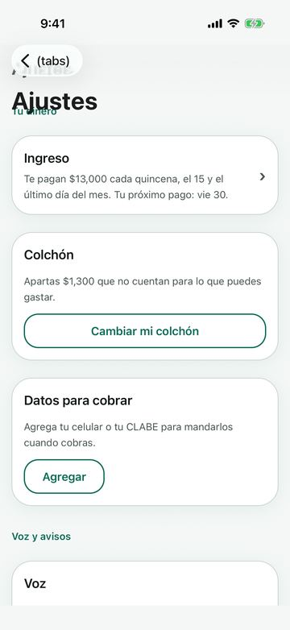 | 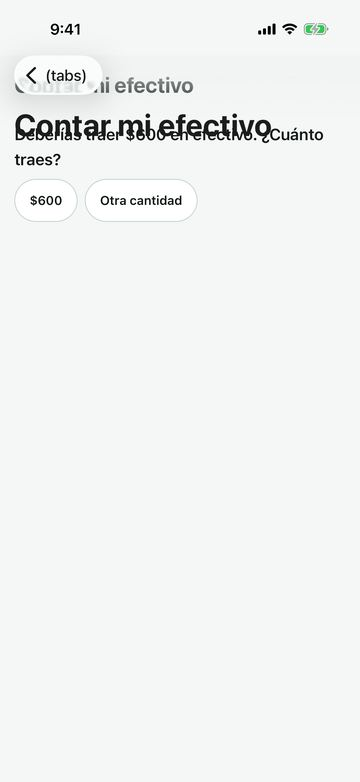 | 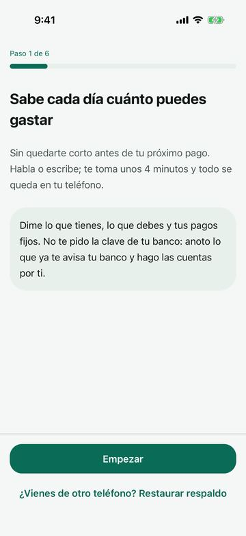 |

Después (CI del 25-10, `7265774`; iPhone en oscuro y Android en claro):

| Ajustes (oscuro) | Ingreso (oscuro) | Contar mi efectivo (oscuro) |
|---|---|---|
| 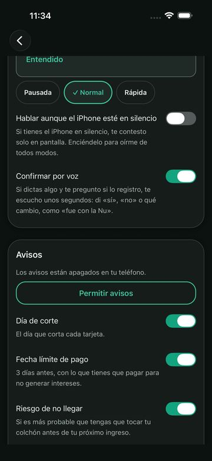 | 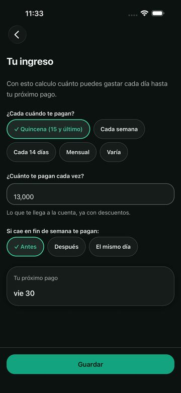 | 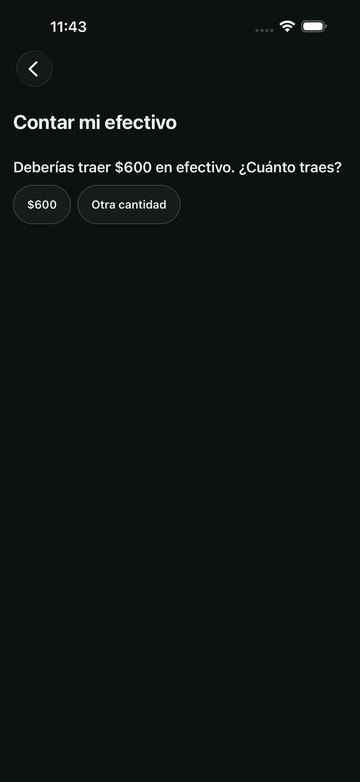 |

| Tú en filas (oscuro) | Bienvenida en Android | C9 · teclado en Android (antes) |
|---|---|---|
| 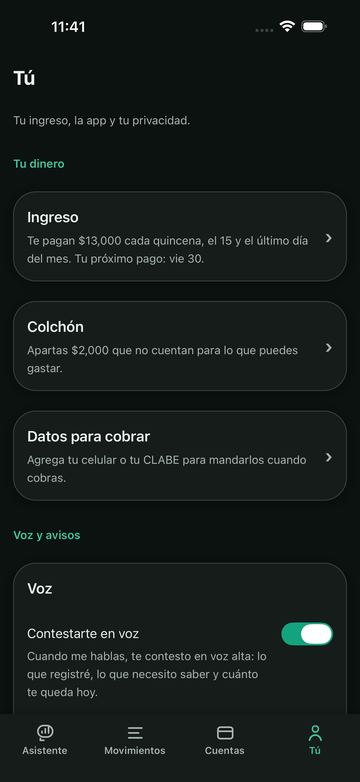 | 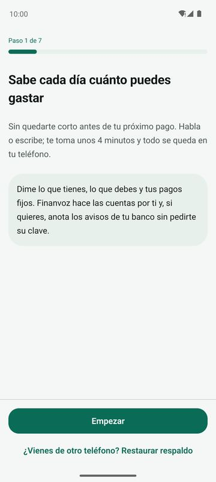 | 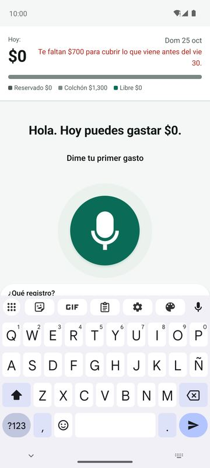 |

## 2. Hallazgos abiertos

| # | Hallazgo | Dónde | Severidad | Tipo | Propuesta |
|---|---|---|---|---|---|
| H1 | La barra de voz (chips + orbe) tapa el final de la conversación: en «No entendí» las últimas opciones quedan bajo los chips; en el estado vacío se corta la ayuda | Asistente | Alta | Error | Margen inferior del área de conversación = alto real de la barra; desplazar al último turno. Mockup 1 |
| H2 | El desglose se dibuja encima del orbe sin velo ni borde; parece un error y no es evidente cómo cerrarlo | Asistente | Media | Diseño | Hoja con velo, asa y «Cerrar», «¿Me alcanza?» al pie. Mockup 2 |
| H3 | Cada «Registré…» es una tarjeta alta con «Deshacer» suelto; con tres registros la conversación se llena de aire | Asistente | Media | Diseño | Una fila: monto, qué, cuenta y «Deshacer» de 48 dp. Mockup 3 |
| H4 | Cabecera: «$0» compite con un párrafo rojo a la derecha y una leyenda de tres colores | Asistente | Media | Diseño | Cifra, una línea de estado (solo el monto en rojo) y la barra como botón «Ver». Mockup 4 |
| H5 | Cuentas: «Efectivo / Efectivo», acciones como enlaces sueltos, vacío de «Debes» casi tan alto como una cuenta | Cuentas | Baja | Diseño | Lista con › como Ajustes, total por sección, acciones en chips. Mockup 5 |
| H6 | Movimientos: día en verde y total en otra línea; «Por revisar» ocupa más que dos movimientos | Movimientos | Baja | Diseño | Día con total a la derecha, «Por revisar · n» en una fila. Mockup 6 |
| H7 | «¿Cuánto llevo en comida?» contesta «es parte de Plus» aunque el nivel 0 ya lo calcula sin nube | Asistente | Media | Producto | Decidir si las consultas del nivel 0 son gratis (no cuestan IA) |
| H8 | O3: el monto se escribe sin separador de miles («13000») y en Ajustes sale «13,000» | Onboarding | Baja | Error | Formato en vivo de `CampoMonto` también en O3 |
| H9 | Íconos de sistema (`expo-symbols`) pendientes (PLAN-UX 3.5) | Todo | Baja | Diseño | Lista de íconos por pantalla para aprobar |
| H10 | Maestro de iPhone nunca ha estado en verde (flujos atrás de la Ola 7) | CI | Media | Pruebas | Flujos al día (25-10: `tocar` centrado, «¿Me alcanza?» opcional, 05 con «Enviar»); seguir hasta verde |

Capturas (CI del 25-10, `286f14f`; las pantallas no cambiaron el 25-10 salvo Ajustes y la bienvenida):

| H1 · conversación tapada | H2 · desglose | H3 · registros |
|---|---|---|
| 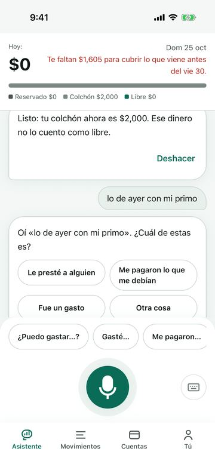 | 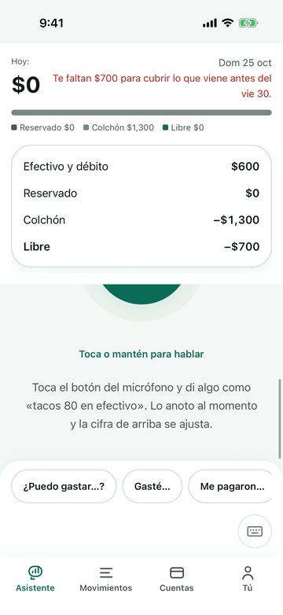 | 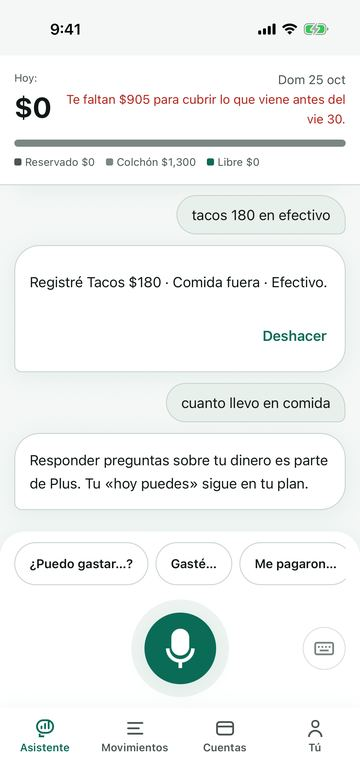 |

| H5 · cuentas | H6 · movimientos |
|---|---|
| 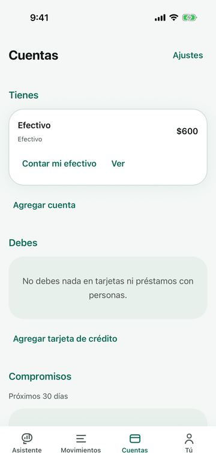 | 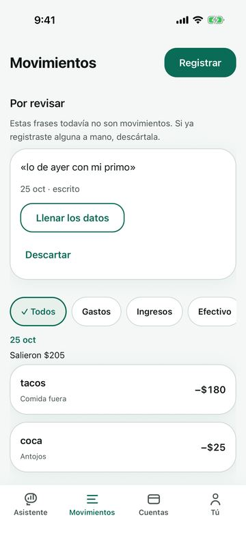 |

## 3. Lo que está bien y no se toca

- La renovación de tokens del 24-10 (fondo más cálido, radios 8/14/20/28, sombras suaves) mantiene el contraste AA
  (`tokens.test.ts`) y se ve coherente en claro y oscuro.
- Movimientos con `SectionList`, totales por día y chips: rápido con listas largas y accesible (encabezados de día).
- Asistente: el orbe como acción principal y el teclado secundario siguen la Ola 7.
- Textos sin tecnicismos y con tuteo (`02 §14`); «No entendí» con una sola pregunta y la respuesta más probable
  primero (`02 §1.2`).

## 4. Decisión que se pide a Adam

1. ¿Se corrige H1 (error, sin cambio de diseño)?
2. ¿Qué mockups (2 a 6) se construyen?
3. H7: ¿las consultas que el nivel 0 contesta sin nube son gratis?

Hasta tener respuesta no se construye nada de la sección 2.
